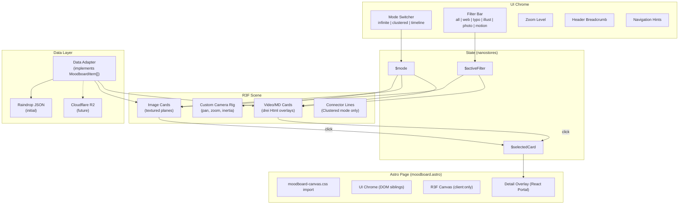

# Moodboard Canvas Page

## Overview

Replace the current flat masonry moodboard page with an immersive React Three Fiber canvas supporting three layout modes: Infinite (3D fly-through with parallax depth), Clustered (2D category grouping), and Timeline (2D chronological). Cards display images, videos, and markdown. The page consumes data via a shared TypeScript interface, initially backed by the existing Raindrop JSON.

## Problem Frame

The current moodboard is a static image grid pulled from a Raindrop JSON dump. It has no interactivity, no spatial richness, and only supports images. The goal is a canvas experience where visitors can fly through a 3D constellation of cards, view them clustered by category, or browse chronologically — with support for images, video embeds, GIFs, and markdown content. (see origin: `docs/brainstorms/2026-04-19-moodboard-canvas-requirements.md`)

## Requirements Trace

- R1. Single R3F canvas as `client:only="react"` island; UI chrome as sibling DOM
- R2. drei for camera controls, `<Html>` overlays, scene utilities
- R3. Cards display image, video, or markdown by content type
- R4. Three modes: Infinite, Clustered, Timeline
- R5. Infinite: perspective camera, cards at varying Z-depths, fly-through navigation, parallax
- R6. Clustered: orthographic camera, category grouping, connector lines, filter-to-focus
- R7. Timeline: orthographic camera, chronological along horizontal spine
- R8. Animated camera and card position transitions between modes
- R9. Pan, zoom, pinch, inertia across all modes
- R10. Card click opens detail overlay with full media and metadata
- R11. Filter bar by category/tag with fade/shrink for non-matching
- R13. Image cards as textured planes
- R14. Video cards: YouTube/GIF support
- R15. Markdown cards via drei `<Html>`
- R16. Shared TypeScript moodboard item interface
- R17. Data-source agnostic
- R18. Initial dev against existing Raindrop JSON or mock data
- R19. Glass-morphism UI chrome
- R20. Globe SVG icon in top-left
- R21. Navigation hint text
- R22. FPS debug overlay (keyboard-activated)

## Scope Boundaries

- Read-only display — no content management
- Filtering by category only — no search
- `client:only` — no SSR of the R3F canvas
- Content pipeline and migration are separate workstreams

## Context & Research

### Relevant Code and Patterns

- `src/pages/moodboard.astro` — current page, uses `RaindropWrapper` component in `BaseLayout`
- `src/components/RaindropWrapper.astro` — fetches from static JSON, renders masonry grid
- `src/components/GradientBackground.tsx` — best reference for `client:only="react"` + animation pattern
- `src/layouts/BaseLayout.astro` — layout wrapper, imports global styles
- `src/styles/variables.css` — design tokens: `--color-accent` (#5E7D56), `--color-bg` (#F4F3EF), spacing scale, fluid type
- `src/content/moodboard/raindrop-collection.json` — 5,700+ line Raindrop data dump
- `src/components/Card.tsx` — Cloudinary image pattern, hover overlays
- `src/components/FavoritesCollectionHandler.tsx` — nanostores state management pattern

### External References

- React Three Fiber: `r3f.docs.pmnd.rs`
- drei: `drei.docs.pmnd.rs` (Html, OrbitControls, useTexture)
- @react-spring/three: `react-spring.dev` — spring animations for position/camera transitions
- Codrops infinite canvas: `tympanus.net/codrops/2026/01/07/infinite-canvas-building-a-seamless-pan-anywhere-image-space/`
- Codrops 3D product grid: `tympanus.net/codrops/2026/02/24/from-flat-to-spatial-creating-a-3d-product-grid-with-react-three-fiber/`

## Key Technical Decisions

- **Camera transition approach:** Use a single perspective camera and interpolate FOV + position for mode transitions. For Clustered and Timeline modes, set a very high FOV with the camera pulled far back to approximate orthographic projection. This avoids the complexity of swapping camera instances and keeps transitions seamless. If the approximation is insufficient, fall back to a crossfade between two cameras during implementation.
- **Card rendering strategy:** Image cards use textured `<mesh>` planes (Three.js `TextureLoader` + `planeGeometry`) for performance at scale. Video and markdown cards use drei `<Html>` overlays positioned at the card's world coordinates. This hybrid approach keeps image rendering fast while supporting rich DOM content where needed.
- **Spring animations for transitions:** `@react-spring/three` for animating card positions, rotations, and opacity between layout modes. Springs provide natural-feeling easing and handle interrupts gracefully (switching modes mid-transition).
- **Navigation rig:** Custom camera rig rather than OrbitControls. OrbitControls orbits around a target point, which doesn't match the fly-through metaphor. The custom rig supports: WASD/drag for panning, scroll for zoom (Z-axis movement in Infinite, scale in 2D modes), inertia via spring damping. Built as a reusable hook.
- **Layout calculators as pure functions:** Each mode has a pure function that takes the item array and returns position/rotation/scale for each card. The scene component reads the current mode and spring-animates cards to the target positions. Adding a new mode means adding one calculator function.
- **State management:** nanostores (already in the project) for cross-cutting state: current mode, active filter, selected card. R3F components subscribe via `@nanostores/react`. UI chrome DOM elements and canvas components share the same stores.
- **Mobile-first performance:** Touch controls (drag, pinch-to-zoom), responsive card sizing, aggressive texture optimization. Target 60fps on mobile devices. Camera rig supports both pointer and touch events.
- **Detail overlay as DOM, not canvas:** The card detail view (R10) is a React portal rendered as a sibling to the canvas, not inside the scene. This matches the mockup's approach and avoids the complexity of in-scene modal rendering.
- **Video preview on hover:** Video cards show static thumbnails by default. On hover, mount a drei `<Html>` overlay with `lite-youtube-embed` positioned at the card location — this gives a richer preview without loading the full iframe. On click, the detail overlay opens with full playback. Only one card has an active preview at a time (the hovered one), keeping performance controlled.
- **CSS import location:** All canvas-related CSS lives in a dedicated stylesheet imported from the Astro page file, per CLAUDE.md rule about `client:only` components.
- **UI chrome animations:** CSS transitions for button states, overlay fades, and simple interactions. No GSAP — keep dependencies minimal.

## Open Questions

### Resolved During Planning

- **Camera control scheme for fly-through?** Custom camera rig with drag-to-pan, scroll-to-zoom, and spring-based inertia. OrbitControls rejected — wrong interaction model for fly-through.
- **Perspective ↔ orthographic transition?** Single perspective camera with FOV interpolation to approximate orthographic for 2D modes. Avoids camera swap complexity.
- **YouTube embeds in WebGL?** Thumbnail in canvas, iframe playback in detail overlay (DOM). No in-scene video textures.
- **Image cards: textured planes or `<Html>`?** Textured planes for images (fast), `<Html>` only for video/markdown cards.
- **UI chrome layering?** Sibling DOM elements with z-index, not drei `<Html>`. Clarified in R1.

### Deferred to Implementation

- Exact FOV range for the orthographic approximation — needs visual tuning
- Specific spring config values (tension, friction) — needs feel testing
- Image texture loading strategy (eager vs. lazy, resolution tiers) — depends on observed performance
- Connector line rendering in Clustered mode — SVG overlay or Three.js `<Line>` from drei

## High-Level Technical Design

> *This illustrates the intended approach and is directional guidance for review, not implementation specification. The implementing agent should treat it as context, not code to reproduce.*



## Output Structure

```
src/
  pages/
    moodboard.astro                    # Page shell, CSS import, mounts canvas + chrome
  components/
    moodboard/
      MoodboardCanvas.tsx              # R3F Canvas root component
      CameraRig.tsx                    # Custom camera controls (pan, zoom, inertia)
      CardMesh.tsx                     # Image card (textured plane)
      HtmlCard.tsx                     # Video/markdown card (drei Html)
      DetailOverlay.tsx                # Card detail modal (React portal)
      ModeSwitch.tsx                   # Mode toggle UI
      FilterBar.tsx                    # Category filter UI
      DebugOverlay.tsx                 # FPS/perf stats (keyboard toggle)
      layouts/
        infinite.ts                    # 3D fly-through position calculator
        clustered.ts                   # 2D category grouping calculator
        timeline.ts                    # 2D chronological calculator
      stores.ts                        # nanostores: mode, filter, selectedCard
      data-adapter.ts                  # Fetches + normalizes data to MoodboardItem[]
  styles/
    moodboard-canvas.css               # All canvas-related styles
  types/
    moodboard.ts                       # Shared interface (created in content pipeline Unit 1)
```

## Implementation Units

- [x] **Unit 1: Data adapter and stores**

  **Goal:** Create the data adapter that reads from existing Raindrop JSON (or mock data) and exposes `MoodboardItem[]`, plus nanostores for shared state.

  **Requirements:** R16, R17, R18

  **Dependencies:** Shared `MoodboardItem` type from `src/types/moodboard.ts` (content pipeline Unit 1, or create it here if starting moodboard first)

  **Files:**
  - Create: `src/types/moodboard.ts` (if not already created by content pipeline)
  - Create: `src/components/moodboard/data-adapter.ts`
  - Create: `src/components/moodboard/stores.ts`

  **Approach:**
  - Data adapter: function that reads `raindrop-collection.json`, maps each Raindrop item to `MoodboardItem`. Normalizes `_id` → `raindrop:{_id}`, `cover` → `mediaUrl`, `type` → `contentType`, `created` → `date`. Assigns category from tags using keyword matching (same logic as content pipeline).
  - Stores: `$mode` (atom, default `'infinite'`), `$activeFilter` (atom, default `'all'`), `$selectedCard` (atom, default `null`), `$debugMode` (atom, default `false`)
  - Export a `useItems()` hook that returns filtered items based on `$activeFilter`

  **Patterns to follow:**
  - `src/components/FavoritesCollectionHandler.tsx` — nanostores usage pattern
  - `src/content/moodboard/raindrop-collection.json` — source data structure

  **Test scenarios:**
  - Happy path: Adapter returns array of `MoodboardItem` from Raindrop JSON
  - Happy path: All required fields populated (id, title, date, mediaUrl, contentType)
  - Edge case: Raindrop items with missing `cover` get a placeholder or are filtered out
  - Edge case: Items with unknown type fall back to `'image'` contentType
  - Happy path: `$activeFilter` set to `'photography'` → `useItems()` returns only photography items
  - Happy path: `$activeFilter` set to `'all'` → `useItems()` returns all items

  **Verification:**
  - Data adapter produces valid `MoodboardItem[]` from the existing JSON
  - Stores react to updates and filtered items update accordingly

- [x] **Unit 2: R3F canvas shell and custom camera rig**

  **Goal:** Mount the R3F canvas as a `client:only="react"` island with a custom camera rig supporting pan, zoom, and inertia.

  **Requirements:** R1, R2, R5, R9

  **Dependencies:** Unit 1 (stores for mode/zoom)

  **Files:**
  - Modify: `src/pages/moodboard.astro`
  - Create: `src/components/moodboard/MoodboardCanvas.tsx`
  - Create: `src/components/moodboard/CameraRig.tsx`
  - Create: `src/styles/moodboard-canvas.css`

  **Approach:**
  - `moodboard.astro`: import `moodboard-canvas.css`, render `MoodboardCanvas` with `client:only="react"`, add empty DOM containers for UI chrome (Units 5-6)
  - `MoodboardCanvas.tsx`: `<Canvas>` with perspective camera, ambient + directional light, fog for depth in Infinite mode. Reads `$mode` to adjust camera FOV.
  - `CameraRig.tsx`: Custom hook/component that handles:
    - Pointer drag → camera panning (x/y translation)
    - Scroll → zoom (z-axis movement in Infinite, scale factor in 2D modes)
    - Pinch → zoom (touch devices)
    - Spring-based inertia on release (velocity tracking + damped spring)
  - Camera starts centered in the scene with a default FOV and position suitable for Infinite mode
  - CSS: canvas fills viewport, `pointer-events: none` on chrome containers with `pointer-events: auto` on interactive children

  **Patterns to follow:**
  - `src/components/GradientBackground.tsx` — `client:only` mounting pattern
  - Codrops infinite canvas — drag + inertia implementation approach
  - Codrops 3D product grid — spring-damped camera rig with bounded drag

  **Test scenarios:**
  - Happy path: Canvas renders and fills viewport on moodboard page
  - Happy path: Drag pans the camera smoothly
  - Happy path: Scroll zooms in/out with smooth interpolation
  - Happy path: Releasing a fast drag produces inertia (camera continues moving and decelerates)
  - Edge case: Zoom clamped to min/max bounds (no infinite zoom in/out)
  - Happy path: `$zoom` store updates as user scrolls

  **Verification:**
  - R3F canvas visible on `/moodboard`
  - Camera responds to drag and scroll with inertia
  - No console errors, no hydration warnings

- [x] **Unit 3: Layout calculators (Infinite, Clustered, Timeline)**

  **Goal:** Implement three pure functions that compute target position, rotation, and scale for each card given the current mode and filter state.

  **Requirements:** R4, R5, R6, R7, R11

  **Dependencies:** Unit 1 (MoodboardItem type and data)

  **Files:**
  - Create: `src/components/moodboard/layouts/infinite.ts`
  - Create: `src/components/moodboard/layouts/clustered.ts`
  - Create: `src/components/moodboard/layouts/timeline.ts`

  **Approach:**
  - Each function signature: `(items: MoodboardItem[], filter: string) → CardLayout[]` where `CardLayout` is `{ id, x, y, z, rotX, rotY, rotZ, scale, opacity }`
  - **Infinite:** Distribute cards in a 3D volume. Use deterministic seeded random from item ID for position consistency across renders. Spread across X/Y/Z with Z-depth varying from near to far. Slight random rotation per card. Filtered-out cards: opacity 0.1, scale 0.8.
  - **Clustered:** Compute category centers in a circle (like the mockup). Items scatter around their category center with polar distribution. Tight radius when a single category is filtered; wide radius otherwise. Filtered-out cards pushed outward with low opacity.
  - **Timeline:** Sort by date. Space evenly along X-axis. Alternate Y offset (above/below spine). Small random Y jitter. Z = 0 for all.
  - All three produce consistent `CardLayout` shape — the scene just animates to whichever layout is active.

  **Patterns to follow:**
  - Mockup's `generateData` function — category centers, scatter/cluster/timeline position logic

  **Test scenarios:**
  - Happy path: Infinite layout assigns different Z-depths, creating visible parallax potential
  - Happy path: Clustered layout groups items by category — items in same category have similar x/y
  - Happy path: Timeline layout sorts by date — earlier dates have smaller X values
  - Edge case: Single item produces valid layout (no division by zero)
  - Edge case: All items same category — Clustered layout still distributes them, doesn't stack
  - Happy path: Filtering to one category in Clustered mode tightens the radius for matching items
  - Happy path: Filtered-out items get opacity < 1 and reduced scale

  **Verification:**
  - Each calculator returns a `CardLayout` for every input item
  - Positions are deterministic (same input → same output)

- [~] **Unit 4: Card mesh and Html card components** — *image and video done; markdown has no backing data*

  **Goal:** Create the card components that render inside the R3F scene — textured plane for images, drei `<Html>` for video thumbnails and markdown.

  **Requirements:** R3, R13, R14, R15

  **Dependencies:** Unit 1 (data types), Unit 2 (scene exists)

  **Files:**
  - Create: `src/components/moodboard/CardMesh.tsx`
  - Create: `src/components/moodboard/HtmlCard.tsx`

  **Approach:**
  - `CardMesh.tsx`: For image and video items. Uses `useTexture` (drei) to load thumbnail as texture. Renders a `<mesh>` with `<planeGeometry>` and `<meshBasicMaterial map={texture}>`. Accepts animated `position`, `rotation`, `scale`, `opacity` from spring values. Click handler writes to `$selectedCard`. Hover: slight scale bump + cursor change.
  - For **video cards specifically:** On hover, conditionally mount a drei `<Html>` overlay with `lite-youtube-embed` positioned at the card's world coordinates. This gives a rich preview UI without loading the full YouTube iframe. On unhover, unmount the overlay. Only one card can be hovered at a time, so performance is bounded.
  - `HtmlCard.tsx`: For markdown items only. Uses drei `<Html>` at the card's world position with rendered markdown content (parse `.md` to HTML at data-adapter level or use a lightweight markdown renderer).
  - All components accept the same `CardLayout` spring props for animated transitions.
  - Image/video textures loaded lazily — only load when within a distance threshold of the camera (or use drei `useTexture` with Suspense).

  **Patterns to follow:**
  - drei `useTexture` documentation
  - drei `<Html>` documentation for DOM-in-scene overlays

  **Test scenarios:**
  - Happy path: Image card renders a visible textured plane in the scene
  - Happy path: Video card renders a thumbnail texture by default
  - Happy path: Hovering a video card mounts the lite-youtube-embed overlay
  - Happy path: Unhovering a video card unmounts the overlay (cleanup)
  - Happy path: Markdown card renders formatted text content
  - Happy path: Clicking any card type sets `$selectedCard` to that item
  - Edge case: Image with slow/failed load shows placeholder (Suspense fallback)
  - Happy path: Cards animate position/rotation/scale when layout changes
  - Edge case: Only one video preview active at a time (no memory leak from multiple overlays)

  **Verification:**
  - All three content types render visibly in the scene
  - Cards are clickable and interactive

- [x] **Unit 5: Scene composition and mode transitions**

  **Goal:** Wire cards, layouts, and camera together. Switching modes animates all cards to new positions and adjusts the camera.

  **Requirements:** R4, R5, R6, R7, R8

  **Dependencies:** Unit 2, Unit 3, Unit 4

  **Files:**
  - Modify: `src/components/moodboard/MoodboardCanvas.tsx`

  **Approach:**
  - `MoodboardCanvas` reads `$mode` and `$activeFilter` from stores
  - Include drei `<Stats>` component (or r3f-perf's `<Perf>`) for FPS monitoring, toggled by `$debugMode` store (keyboard shortcut: Shift+D)
  - On mode/filter change: calls the active layout calculator, produces target `CardLayout[]`
  - Each card component receives its target layout as spring-animated props via `@react-spring/three`
  - Camera FOV and position animate via spring to match the mode:
    - Infinite: lower FOV (60-75), camera positioned within the card volume
    - Clustered: high FOV (120+) or camera pulled far back on Z, looking at center
    - Timeline: high FOV, camera centered on the timeline spine
  - Spring config: medium tension, moderate friction for a smooth but responsive feel. Values tuned during implementation.
  - Handle mid-transition interrupts: switching mode during an active transition should retarget springs, not queue.

  **Patterns to follow:**
  - `@react-spring/three` animated mesh pattern
  - Mockup's `updateLayout` + `centerCamera` functions — conceptual flow reference

  **Test scenarios:**
  - Happy path: Switching from Infinite to Clustered animates all cards to category groupings
  - Happy path: Switching from Clustered to Timeline rearranges cards chronologically
  - Happy path: Camera position/FOV transitions smoothly between modes
  - Happy path: Switching modes mid-transition completes smoothly (no snapping or freezing)
  - Happy path: Changing filter in Clustered mode tightens the focused cluster and fades others
  - Edge case: Switching mode with an active filter preserves the filter state

  **Verification:**
  - All three modes render correctly with smooth transitions between them
  - No visual artifacts during transitions

- [x] **Unit 6: UI chrome (mode switcher, filter bar, globe icon, hints, debug overlay)**

  **Goal:** Build the glass-morphism overlay controls as sibling DOM elements to the canvas.

  **Requirements:** R11, R19, R20, R21, R22

  **Dependencies:** Unit 1 (stores), Unit 2 (page structure)

  **Files:**
  - Create: `src/components/moodboard/ModeSwitch.tsx`
  - Create: `src/components/moodboard/FilterBar.tsx`
  - Create: `src/components/moodboard/DebugOverlay.tsx`
  - Modify: `src/pages/moodboard.astro`
  - Modify: `src/styles/moodboard-canvas.css`

  **Approach:**
  - All chrome components are React components mounted alongside the canvas in `moodboard.astro` (using `client:only="react"` or `client:load`)
  - Each component reads/writes nanostores — `ModeSwitch` writes `$mode`, `FilterBar` writes `$activeFilter`, `DebugOverlay` reads `$debugMode` (toggled via keyboard listener: Shift+D)
  - Glass-morphism styling: `backdrop-filter: blur(12px)`, semi-transparent background (`rgba(244,243,239,0.75)`), subtle border (`1px solid rgba(0,0,0,0.05)`), border-radius for pill shapes
  - Active button states use accent color (`--color-accent` / #5E7D56)
  - `ModeSwitch`: three buttons (infinite, clustered, timeline) with phosphor icons, top-right
  - `FilterBar`: "all" plus five category buttons, bottom-center position
  - Globe icon: SVG globe icon, top-left corner, links to home or serves as visual branding
  - Hints: `drag to pan · scroll to zoom · click to inspect`, bottom-right, low opacity
  - `DebugOverlay`: Shows FPS, memory, render time when active (drei `<Stats>` output or custom display)
  - All animations via CSS transitions (button hover, active states, overlay fades) — no JavaScript animation library
  - Mobile: touch-friendly button sizing (44px min), responsive positioning
  - Fixed positioning with z-index above canvas
  - CSS lives in `moodboard-canvas.css`, imported from `moodboard.astro`

  **Patterns to follow:**
  - Mockup's glass-ui class and layout positioning
  - Existing `src/styles/variables.css` design tokens

  **Test scenarios:**
  - Happy path: Mode switcher renders three buttons, clicking each updates `$mode`
  - Happy path: Active mode button has accent-colored background
  - Happy path: Filter bar renders "all" + five category buttons
  - Happy path: Clicking a filter updates `$activeFilter` and highlights the active button
  - Happy path: Shift+D toggles debug overlay visibility
  - Happy path: Debug overlay shows FPS counter when visible
  - Happy path: Globe icon renders in top-left corner
  - Happy path: All chrome has frosted glass appearance with CSS transitions on hover
  - Edge case: Chrome is interactive (pointer-events) while canvas behind it is not blocked
  - Happy path: On mobile, buttons are touch-friendly (44px+ tap target)

  **Verification:**
  - All UI chrome visible and interactive over the canvas
  - State changes in chrome reflected in the scene

- [x] **Unit 7: Detail overlay**

  **Goal:** Clicking a card opens a full detail view with media, metadata, and tags.

  **Requirements:** R10

  **Dependencies:** Unit 1 (stores, data types), Unit 4 (card click wiring)

  **Files:**
  - Create: `src/components/moodboard/DetailOverlay.tsx`
  - Modify: `src/styles/moodboard-canvas.css`

  **Approach:**
  - React portal rendered as a sibling to the canvas, not inside the scene
  - Subscribes to `$selectedCard` — when non-null, overlay appears with entry animation
  - Layout: full-viewport overlay with frosted backdrop, content card split into media area (60%) and info panel (40%) — matching the mockup
  - Media area: full image for images, YouTube iframe for videos, rendered markdown for text
  - Info panel: item ID badge, date, category (accent color), title, description, tags as pills
  - Close button (top-right) + click-outside-to-close + Escape key → sets `$selectedCard` to null
  - Entry animation: fade overlay + slide-up content card
  - Exit animation: fade out

  **Patterns to follow:**
  - Mockup's `detail-overlay` structure and styling
  - Existing `@radix-ui/react-dialog` usage pattern for accessibility (focus trap, Escape handling)

  **Test scenarios:**
  - Happy path: Clicking an image card opens overlay with full image displayed
  - Happy path: Clicking a video card opens overlay with YouTube iframe playing
  - Happy path: Clicking a markdown card opens overlay with rendered markdown
  - Happy path: Close button dismisses overlay
  - Happy path: Escape key dismisses overlay
  - Happy path: Click outside content area dismisses overlay
  - Happy path: Metadata fields (id, date, category, title, description, tags) all populated
  - Edge case: Opening a new card while overlay is open swaps content without close/reopen flicker

  **Verification:**
  - Detail overlay opens and closes smoothly
  - All content types display correctly in the overlay
  - Focus management works (no background scrolling/interaction while open)

- [~] **Unit 8: Polish and integration testing** — *prod build verified against dev; mobile device testing and connector lines outstanding, see FOLLOW-UP.md*

  **Goal:** Wire everything together, test full flow across modes, ensure production build works.

  **Requirements:** R1 (CSS import rule), R8 (transition quality), all success criteria

  **Dependencies:** All previous units

  **Files:**
  - Modify: `src/pages/moodboard.astro` (final assembly)
  - Modify: `src/styles/moodboard-canvas.css` (final adjustments)

  **Approach:**
  - Full integration pass: load page, verify all three modes render and transition
  - Verify data loads from Raindrop JSON adapter
  - Test filter + mode combinations
  - Run `pnpm build` and verify production output (CLAUDE.md: compare prod vs dev)
  - Verify CSS extraction works (known issue with `client:only` components)
  - Performance check: profile with browser DevTools, ensure smooth 60fps for transitions with full dataset
  - Tune spring configs for feel
  - Add loading state/fallback for initial data fetch and texture loading

  **Test scenarios:**
  - Integration: Load page → default Infinite mode with cards at varying depths
  - Integration: Switch to Clustered → cards group by category with connectors
  - Integration: Switch to Timeline → cards arrange chronologically
  - Integration: Apply filter → matching cards highlight, others fade
  - Integration: Click card → detail overlay opens with correct data
  - Integration: Close detail → return to canvas, state preserved
  - Happy path: `pnpm build` succeeds without errors
  - Happy path: Production build renders identically to dev server
  - Edge case: Page with no data shows graceful empty state

  **Verification:**
  - Complete user flow works end-to-end
  - Production build matches dev
  - No console errors or warnings

- [x] **Unit 9: Performance optimization and THREE.Clock deprecation fix**

  **Goal:** Fix choppy performance and THREE.Clock deprecation warning.

  **Requirements:** R9 (smooth navigation), R22 (debug overlay)

  **Dependencies:** Unit 2 (CameraRig), Unit 5 (scene composition)

  **Outcome:** Console is clean (THREE.Clock patched at R3F source via `patches/@react-three__fiber@9.6.0.patch`; proxy-image returns transparent PNG on failure). Performance: p50=8.3ms, p95=20.1ms, p99=52ms with 3 severe stalls per 121 frames during drag+zoom. p95 still above the 16ms target — root cause is full 625-card layout rebuild on every chunk boundary cross. Addressed in Unit 10.

- [~] **Unit 10: Chunk boundary stall fix (incremental chunk-delta)** — *architecture landed, perf regressed*

  **Goal:** Eliminate p95/p99 stalls during simple pan and zoom by moving from full-array layout rebuild to incremental chunk-delta updates. Target: p95 ≤ 16ms, p99 ≤ 33ms, zero severe stalls (>50ms) during steady-state interaction.

  **Requirements:** R9 (smooth navigation across all modes)

  **Dependencies:** Unit 9 (baseline fixes + measurement)

  **Context:** Two independent analyses converged on the same recommendation.
  - Local repo analysis: `docs/analysis/chunk-boundary-stall-analysis.md` — traces the hot path and scores five strategies; incremental chunk-delta wins at 4/5 fit.
  - External research (Codrops tutorial + `edoardolunardi/infinite-canvas` repo) — confirms the reference implementation uses stable chunk keys (`"${cx},${cy},${cz}"`) + `requestIdleCallback` scheduling, and explicitly avoids `InstancedMesh` for exactly the per-card-texture reason we have.

  **Why this vs alternatives (see analysis doc for full scoring):**
  - Incremental chunk-delta (recommended, 4/5): attacks the root cause; preserves object identity for unchanged chunks so `React.memo` actually works; ~80 LOC change.
  - Web Worker (2/5): moves the work off-thread but doesn't reduce it; postMessage + serialization adds latency; useless without the delta.
  - `InstancedMesh` (1/5): requires shared material → texture atlas for 625 unique images; also loses per-card raycasting and breaks `@react-spring/three`. Codrops doesn't use it either.
  - Object pooling (3/5): fixed pool of meshes with in-place mutation; abandons the declarative model and complicates mode transitions.
  - Pure imperative `useFrame` (2/5): full rewrite away from R3F idioms.

  **Strategy:**
  1. **Data shape.** Change layout state from flat `CardLayout[]` to `Map<chunkKey, CardLayout[]>` keyed by `"cx,cy,cz"`.
  2. **Delta computation.** On `throttledCameraChunk` change, compute `toAdd` = new chunks entering render radius, `toRemove` = chunks leaving. Call the chunk generator only for `toAdd`. Splice results into the map; delete `toRemove` keys (optionally retain a 1-chunk buffer past render distance for hysteresis).
  3. **Stable keys.** Card React keys stay `${item.id}-chunk-${cx}-${cy}-${cz}-${i}`; surviving chunks keep the same `CardLayout` object reference so `MemoizedCard` shallow-equals passes.
  4. **Opacity extraction (risk mitigation for filter changes).** Move filter-based opacity out of the baked layout and into `MemoizedCard` render (pass `filterMatch: boolean` as a scalar prop). This way, changing filter doesn't invalidate any cached chunks.
  5. **Mode transitions.** Clear the chunk map when `mode` changes away from `infinite`; rebuild on return. Clustered/timeline keep their current flat-array shape.

  **Files:**
  - Modify: `src/components/moodboard/layouts/infinite.ts` (split into `generateChunkLayouts(cx, cy, cz, items)` helper + export the helper; keep current full-recompute function for first-paint)
  - Modify: `src/components/moodboard/MoodboardCanvas.tsx` (Map-based state, useEffect that runs delta diff on `throttledCameraChunk` change, flatten map for `SceneContent`)
  - Modify: `src/components/moodboard/CardMesh.tsx` (accept `filterMatch` scalar; compute opacity from filter + depth fade internally)

  **Risks to verify during implementation:**
  - Does `@react-spring/three` no-op when target values are unchanged? (If it retargets aggressively, wrap spring config in `useMemo` keyed on layout values.)
  - p99 stall attribution: is it layout rebuild (addressed by this unit) or texture decode/upload? If texture upload dominates, add Unit 11 for `createImageBitmap` off-thread decode.
  - Mode switch (`infinite` → `clustered`) must clear chunk map without flashing stale infinite cards.

  **Test scenarios:**
  - Happy path: drag-pan for 5s → p95 ≤ 16ms, p99 ≤ 33ms, zero stalls >50ms
  - Happy path: continuous scroll-zoom for 5s → same targets
  - Happy path: mode switch infinite → clustered → timeline → infinite completes without visual artifacts
  - Happy path: filter change in infinite mode updates opacity within one frame with no chunk regeneration
  - Edge case: rapid camera movement crossing multiple chunks per throttle window → delta math still converges, no orphaned chunks
  - Edge case: mode transition during active camera motion → chunk map cleared cleanly

  **Verification:**
  - rAF-sampled frame-time distribution over 5s of drag + 5s of zoom meets the targets above.
  - Chrome DevTools performance trace shows reduced main-thread work on chunk boundary frames (layout rebuild frames should drop from ~30ms to <5ms of JS).
  - Console remains clean throughout.
  - Validation agent must not claim success without running the dev server and capturing actual frame-time numbers (prior validation attempt bailed on a Node version mismatch that didn't exist).

- [x] **Unit 11: Remove per-frame React reconciliation from card rendering** — *landed, p95 ~18ms*

  **Goal:** Eliminate the React render path as a source of stalls by moving all per-frame opacity/depth computation out of React and into Three.js object mutations. Target (same as Unit 10): p95 ≤ 16ms, p99 ≤ 33ms, zero stalls >50ms.

  **Context — why Unit 10 regressed:**

  Unit 10 landed the chunk-delta logic correctly (verified: only ~25 chunks diff per crossing, map-based state works). But perf regressed 4× on p95 (20.1ms → 78.2ms). The implementing agent identified the cause in its own report:

  1. `MemoizedCard` receives `cameraChunk` and `cameraZ` as props (MoodboardCanvas.tsx:134-135). `cameraZ` comes from `useThree((state) => state.camera.position)` which updates every frame the camera moves. Every camera motion now invalidates `React.memo` for all 625 cards.
  2. `calculateItemOpacity` runs inside `MemoizedCard` (MoodboardCanvas.tsx:56) during React render — an O(n) computation per frame on the main thread inside the reconciliation loop.
  3. The previous implementation (Unit 9) did the same opacity math but got away with it because the layout array was rebuilt less often. Unit 10's chunk-delta kept `layout` stable but the `cameraZ` prop still changes every frame.

  The fix is not in the chunk-delta layer — that's working. The fix is to remove camera-derived props from the React tree entirely.

  **Requirements:** R9, R22

  **Dependencies:** Unit 10 (chunk-delta architecture must be in place)

  **Strategy: imperative opacity in `useFrame`, not React props**

  1. **Drop `cameraChunk` and `cameraZ` from `MemoizedCard` props.** `MemoizedCard` should only care about `layout`, `item`, `filterMatch`, and `handleCardClick`. All four are now stable across camera motion.
  2. **Move depth/grid fade into `CardMesh` via `useFrame`.** Inside `CardMeshInner`, get a ref to the `<meshBasicMaterial>`. In a `useFrame` callback, read the current camera position from `useThree((s) => s.camera)` (ref, not reactive), recompute opacity from `calculateItemOpacity` + `filterMatch`, write directly to `materialRef.current.opacity`. No React render, no reconciliation, just a GPU-bound uniform update.
  3. **Frustum/distance culling also in `useFrame`.** Toggle `meshRef.current.visible = opacity > 0.01` imperatively. Don't return `null` from React render based on opacity — that remounts the subtree.
  4. **Stable `layout` reference.** Confirmed already: surviving chunks keep the same `CardLayout` object through the chunk-delta logic.
  5. **Flatten overhead.** The current code flattens the map on every throttled chunk change (MoodboardCanvas.tsx:247-252). That's rare (every 100-400ms), not per-frame, so probably fine — but measure. If flattening is a hot spot, render nested: `<>{Array.from(map.values()).map(chunkLayouts => <ChunkGroup key=... layouts={chunkLayouts}/>)}</>` so only the changed chunk re-renders at the React level.

  **Files:**
  - Modify: `src/components/moodboard/CardMesh.tsx` — add `useFrame` for opacity; remove `depthOpacity` prop; accept `filterMatch` + `layoutId` (for chunk-coord extraction inside useFrame).
  - Modify: `src/components/moodboard/MoodboardCanvas.tsx` — strip `cameraChunk` and `cameraZ` from `MemoizedCard`; stop calling `calculateItemOpacity` in render; remove the `if (finalOpacity < 0.01) return null` early-out.

  **Things to NOT change:**
  - The chunk-delta architecture from Unit 10 (keep Map + hysteresis + `generateChunkLayouts`).
  - The R3F patch.
  - CameraRig constants.
  - `<Stats>` gating.
  - Clustered/timeline flat-array path.

  **Risks:**
  - `useFrame` in 600+ CardMesh instances is itself a cost. If p99 still exceeds target, switch to a single `useFrame` in `SceneContent` that iterates `meshRefs.current[]` — one loop instead of 625 callbacks.
  - `useSpring` from `@react-spring/three` is the other potential per-frame React source. It's fine as long as target values are stable (verified via the memoized `springConfig` at CardMesh.tsx:81), but worth confirming with a profile.

  **Validation (same rigor as Unit 10):**

  1. Node 22 via `source ~/.nvm/nvm.sh && nvm use 22.17.1`, `pnpm build` passes.
  2. Dev server up, console clean.
  3. Run the rAF frame-sampler from Unit 10. Must show p95 ≤ 16ms, p99 ≤ 33ms, zero stalls >50ms.
  4. Mode switch smoke test.
  5. If target not met, reduce `useFrame` fan-out (single-loop variant) and re-measure before returning.

  **Test scenarios:**
  - Happy path: drag-pan 5s → targets met
  - Happy path: continuous scroll-zoom 5s → targets met
  - Happy path: filter change in infinite mode → opacity updates within one frame, no chunk regeneration (visually verifiable via debug overlay chunk count staying constant)
  - Happy path: card far outside render distance fades out smoothly without a snap
  - Edge case: switch modes rapidly → no stale cards, no memory leaks from orphaned useFrame callbacks

- [x] **Unit 12: Off-thread texture decode and resolution cap** — *median p95 9.8ms, 82% proxy size reduction*

  **Goal:** Collapse p95/p99 variance caused by texture decode and GPU upload. Target: median p95 ≤ 16ms across 3 runs (not just best run), p99 ≤ 33ms, stalls >50ms ≤ 1 per run.

  **Requirements:** R9

  **Dependencies:** Unit 11b (single-loop useFrame landed)

  **Context — why this is the next lever:**

  Three-run Unit 11b metrics showed p95 ranging 17.1–45.9ms (median 28.8ms) with 5–8 stalls >50ms per run. p50 is rock-solid 8.3ms. Variance like that, where the main-thread work per frame hasn't changed, points to one-off decode/upload spikes when new chunks stream in during scroll. The current `TextureLoader` (CardMesh.tsx:58) decodes on the main thread and uploads to the GPU inline in its onload callback. Each newly-visible chunk triggers 5 of those per boundary crossing.

  **Strategy:**

  1. **Off-thread decode.** Replace `new TextureLoader().load(url, ...)` with:
     ```
     fetch(url) → response.blob() → createImageBitmap(blob) → new THREE.CanvasTexture(bitmap)
     ```
     `createImageBitmap` decodes on a worker-like thread; the main thread only sees the decoded ImageBitmap at the end.
  2. **Defer GPU upload.** Instead of calling `setTexture(new CanvasTexture(bitmap))` inline, schedule via `requestIdleCallback(() => setTexture(...), { timeout: 50 })`. GPU upload happens in idle time, spreading pressure off the interaction frame.
  3. **Cap proxy-image resolution.** `src/pages/api/proxy-image.ts` currently forwards the full upstream image (can be 2000+px). Add a resolution cap — rewrite the image at 512px wide before returning. `sharp` is listed in `package.json` `onlyBuiltDependencies` but not actually installed — run `pnpm add sharp` first. This directly reduces upload bytes and texture memory.
  4. **Keep the shared texture cache.** The existing `textureCache: Map<string, Texture>` in `CardMesh.tsx` already de-dupes across chunk instances — preserve it; just populate with `CanvasTexture` instead of `Texture` from `TextureLoader`.

  **Files:**
  - Modify: `src/components/moodboard/CardMesh.tsx` — swap `TextureLoader` for `fetch + createImageBitmap + CanvasTexture`. Wrap `setTexture` in `requestIdleCallback` with setTimeout fallback.
  - Modify: `src/pages/api/proxy-image.ts` — resize to 512px wide with sharp; keep the transparent-PNG fallback path intact.

  **Things to NOT change:**
  - Chunk-delta architecture (Units 10/11).
  - Single-loop useFrame (Unit 11b).
  - R3F patch, CameraRig, clustered/timeline layouts.

  **Risks:**
  - `createImageBitmap` has uneven browser support for arbitrary orientation/colorspace options. Use the baseline form: `createImageBitmap(blob)` with no options, which is supported in all current Chrome/Firefox/Safari.
  - Sharp resize adds ~5-10ms per cold proxy request. Cache-Control is already set; that amortizes.
  - `requestIdleCallback` isn't in Safari. Fallback: `setTimeout(..., 0)`.
  - If the upstream image is already small, sharp's no-op pass still runs — acceptable overhead, but consider early-return if `width ≤ 512`.

  **Validation — mandatory 3-run sampler:**

  Same rAF-sampler as Unit 11b, run 3 times with 2s pause between runs. Report all three results. **Target: median p95 ≤ 16ms, max p99 ≤ 33ms, stalls_over_50 ≤ 1 per run.**

  Also capture:
  - Network tab: confirm proxy-image responses are ≤ 512px (check `Content-Length` is smaller than pre-Unit-12 baseline).
  - Verify no blurring/quality complaints on cards visually — take a screenshot and inspect.

  **Test scenarios:**
  - Happy path: drag-pan 5s → target met
  - Happy path: continuous scroll 5s with new chunks streaming → no hitch when textures arrive
  - Edge case: proxy-image returns upstream image smaller than 512px → sharp should no-op, not upscale
  - Edge case: upstream returns 4xx/5xx → transparent PNG fallback still works
  - Happy path: card visual quality acceptable at 512px (cards are ~300-500px rendered, so no visible loss)

  **Decision gate:** Skip this unit entirely if the user subjectively finds interaction already smooth. The Unit 11b best-run hit target; cold-start/scrolling-past-new-content is the remaining pain.

  **Post-arc learning:** The three-fix arc (Units 10 + 11/11b + 12) is now captured as a reusable pattern at [`docs/solutions/architecture-patterns/r3f-performance-diagnostic-path-chunk-canvas-2026-04-23.md`](../solutions/architecture-patterns/r3f-performance-diagnostic-path-chunk-canvas-2026-04-23.md). Future R3F infinite-canvas performance work should start there.

## System-Wide Impact

- **Interaction graph:** Moodboard page is self-contained. nanostores are scoped to moodboard components — no shared state with other pages. The data adapter is the only integration seam (currently reads JSON, future reads from R2).
- **Error propagation:** Texture load failures should show fallback placeholders, not crash the scene. Data adapter failures should show an error state, not a blank page.
- **State lifecycle risks:** `$selectedCard` must be cleared on mode switch to avoid stale overlay. Filter state should persist across mode switches.
- **Unchanged invariants:** All other pages (landing, memorabilia) are untouched. The current `RaindropWrapper` component and `moodboard.astro` are replaced, not modified alongside.
- **API surface parity:** The `MoodboardItem` interface is the contract with the content pipeline. Changes to it require updates in both workstreams.

## Risks & Dependencies

| Risk | Mitigation |
|------|------------|
| R3F bundle size increases page load significantly | Code-split the canvas component via `client:only`; lazy-load drei utilities |
| Texture loading for hundreds of images is slow | Lazy-load textures based on camera distance; use low-res thumbnails initially |
| FOV interpolation doesn't convincingly approximate orthographic | Fall back to camera swap with crossfade during implementation |
| Spring animations feel janky with many simultaneous targets | Use `@react-spring/three` mass animations; profile and reduce card count if needed |
| `client:only` CSS extraction issue in production build | CSS imported from Astro page per CLAUDE.md; test prod build early (Unit 2) |

## Sources & References

- **Origin document:** [docs/brainstorms/2026-04-19-moodboard-canvas-requirements.md](docs/brainstorms/2026-04-19-moodboard-canvas-requirements.md)
- Related code: `src/pages/moodboard.astro`, `src/components/GradientBackground.tsx`
- R3F docs: `r3f.docs.pmnd.rs`
- drei docs: `drei.docs.pmnd.rs`
- Codrops references: infinite canvas tutorial, 3D product grid tutorial
- lite-youtube-embed: `github.com/paulirish/lite-youtube-embed`

## Reference: HTML Mockup

The user provided a working HTML mockup demonstrating the three layout modes using GSAP for animations and manual canvas positioning. This is provided as **visual and conceptual reference only** — the implementation uses React Three Fiber, not direct DOM manipulation.

**Key patterns to reference (not port directly):**
- **Category center calculation (Clustered mode):** Items distributed in a circle around the canvas center, with each category having a fixed angle. Items within a category scatter around their center using polar coordinates.
- **Scatter distribution (Infinite mode):** Random X/Y positions with `Math.random()` seeded per item for consistency. Includes random rotation per card.
- **Timeline positioning:** Items sorted by date, spaced along X-axis with alternating Y offset (above/below horizontal spine).
- **Connector lines (Clustered mode):** SVG `<line>` elements drawn between items in the same category, forming a visual graph.
- **Smooth transitions:** GSAP with `expo.out` easing for position/rotation changes when switching modes.
- **Camera centering:** Adjusts viewport translation and scale to frame the active layout (e.g., zooms into a single category when filtered).

The R3F implementation will achieve similar visual results using:
- Three.js 3D positioning instead of DOM transforms
- `@react-spring/three` instead of GSAP for animations
- Pure functions returning `CardLayout[]` instead of imperative GSAP timelines
- Perspective camera with FOV interpolation instead of 2D canvas transforms

The mockup proves the layout algorithms work and provides a feel target for the transitions.
